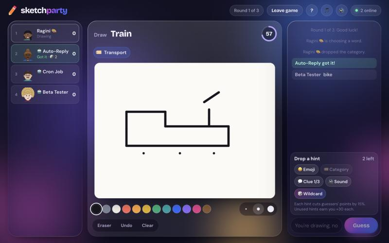
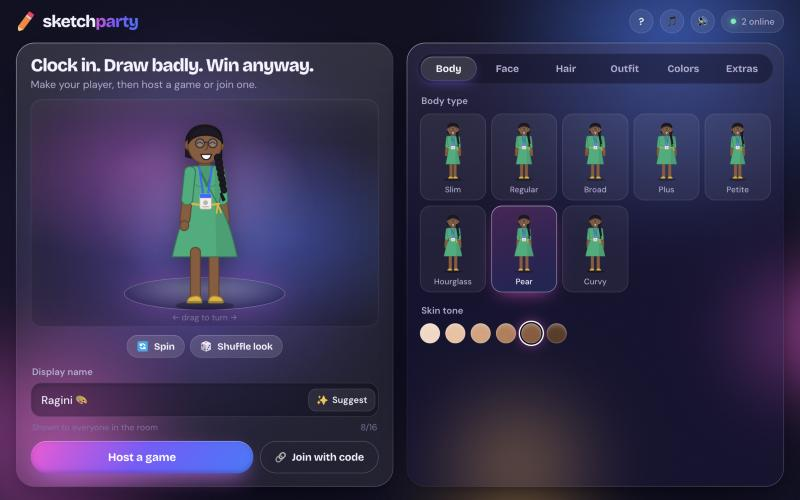

# ✏️ Sketch Party

**Clock in. Draw badly. Win anyway.** A multiplayer draw-and-guess party game for teams, right in the browser. No sign-up: build an avatar, share a link, play.

**▶ Play now:** https://sketch-party-k0ic.onrender.com



## What makes it different

- **Hints that aren't letters.** Drawers can drop an emoji riddle 🟨📝, a category, clues that go from vague to specific, or a sound (bells, engines, sirens, buzzing…). Every hint lowers everyone's points, and unused hints are a bonus for the drawer, so dropping one is a real decision.
- **"🔥 So close!"** A private nudge when your guess is a typo, a plural, or a near miss. Others only see that you're getting warm.
- **Twists.** About half the turns roll a slot machine: One Line, Flashlight, Mirror Hands, 3 Colors, Limited Ink, Shaky Hand or Speed Round.
- **Sabotage.** Guess right to earn coins, then spend them to splat ink on the drawer's screen, shrink their brush, or freeze them for 3 seconds.
- **AI players.** Fill empty seats or play solo. With an Anthropic API key they're powered by Claude: they look at the drawing to guess, and draw their own doodles.
- **Your look.** A 2.5D avatar you can spin around, with 8 body types, 16 hairstyles, office outfits (suits, blouses, dresses, blazers…), facial hair, glasses, headphones, a coffee mug and an ID badge.
- **Office-friendly.** About 180 hand-checked words ("reply all", "inbox zero", "elevator pitch"…), a name filter, and a dark glass look with optional sound and music.



## How to play

1. Pick a look and a name, then **Host a game** and share the invite link, or **Join with code**.
2. The host picks rounds, drawing time, AI players, and whether hints, twists and sabotage are on.
3. Each round, everyone draws once. Choose an easy, medium or hard word, and draw it.
4. Everyone else types guesses. Faster correct guesses score more; the drawer scores for every correct guess.
5. After the last round, the podium crowns the winner. **Play again** goes back to the lobby.

## Run it locally

Requires Node 22+.

```bash
npm install
npm run dev
```

Open http://localhost:5173. To play against yourself, open a second browser profile (or a private window) and join with the room code, or just add AI players.

Tests (with the dev server running):

```bash
npm run smoke -w server        # rooms: join, leave, reconnect, host handoff
npm run smoke:game -w server   # a full 3-player game with hints, coins and sabotage
```

## Deploy your own (Render, free tier)

1. Fork this repo.
2. In Render: **New → Blueprint**, pick your fork. Render reads `render.yaml`.
3. Optionally set `ANTHROPIC_API_KEY` for Claude-powered AI players. Keys live only on the server.
4. Every push to `main` redeploys automatically.
5. Update the `og:image` / `og:url` links in `client/index.html` to your own URL so link previews work.

Free-tier servers sleep after about 15 minutes without players; the first visit after that takes up to a minute while the game shows "Waking up the game server".

## AI players

| Setting | Default | What it does |
|---|---|---|
| `ANTHROPIC_API_KEY` | (none) | Turns on Claude-powered AI players. Without it, AI players use a built-in simulation |
| `AI_MODEL` | `claude-opus-5-5` | Model for AI players. `claude-haiku-5-5` is much cheaper and faster |
| `AI_MAX_CALLS_PER_GAME` | `150` | Cost guard: after this many calls in a game, AI players fall back to the simulation |

## How it's built

```
client/   React + Vite: avatar builder, lobby, canvas, game screens, sounds (Web Audio, no files)
server/   Node + Express + Socket.IO: rooms, game engine, word pack, AI players
shared/   Types and rules used by both (socket events, avatar options, name filter, guess matching)
```

The server is the referee: it runs every timer, checks every guess and keeps the secret word, so nobody can cheat from their browser. Twists and sabotage are enforced on the server too. Rooms live in memory, so a server restart ends games in progress.

## Contributing

See [CONTRIBUTING.md](CONTRIBUTING.md). Ideas welcome: new word packs, twists, outfits and hint types.

## License

Code: [MIT](LICENSE). Animal sound recordings come from Wikimedia Commons under their own licenses; see [CREDITS.md](CREDITS.md).
